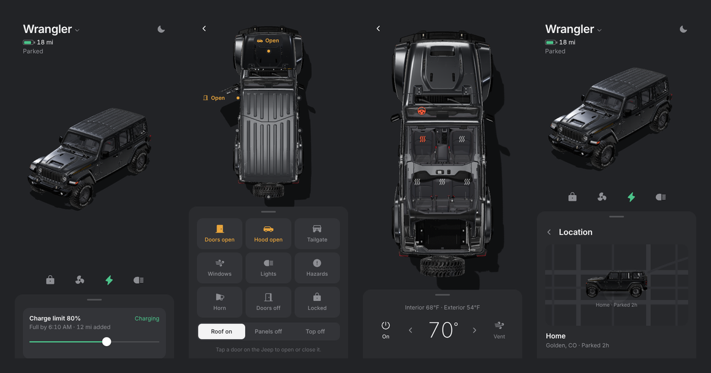

# Jeep Panel

**A Tesla-style app for my Jeep Wrangler 4xe, with a live 3D Jeep you can spin, open and light up.**



**[Open the app](https://milanpatel98.github.io/jeep-panel/)** — works on iPhone, iPad and desktop, and can be added to the home screen.

- **Home** — the Jeep, battery and range, and four controls: lock, climate, charge, lights. Everything else sits in a sheet you swipe up.
- **Controls** — a top-down view. Open any door, the hood or the swing gate, take the front panels or the whole top off, lower the windows, take the doors off, turn on the lights or hazards, sound the horn. The Jeep moves for real, and open parts are tagged on the car.
- **Climate** — roof off, seen from above. Tap a seat or the steering wheel to heat it; set the cabin temperature.
- **Location** — a real dark street map with a tiny 3D Jeep on it, turned the way it's facing, like the cars in Uber.
- **Night** — follows the clock: darker scene, glowing lamps and a soft pool of headlight.

The car's numbers (battery, doors, location) are **sample data** for now. They all live in one place, `src/state.js`, so a real feed can replace them without touching the screens.

## How it works

- **3D** — [three.js](https://threejs.org). The model is repainted in code: gloss black body, black leather, matte black wheels, glass tinted to about 20% see-through. Doors, hood and gate are put on hinges computed from each part's edges; the front wheels steer. The scene only redraws while something moves.
- **Screens** — plain JavaScript, no framework. One layout for phones and a second for iPad landscape and desktop, where the Jeep takes the stage and the controls sit in a column beside it.
- **Icons** — [Phosphor](https://phosphoricons.com) (MIT).
- **Hosting** — GitHub Pages, built by GitHub Actions on every push.

## Run it

```bash
npm install
npm run dev
```

## Credits

**3D model:** "2023 Jeep Wrangler Rubicon 392 20th Anniversary" by [ddiaz-design](https://sketchfab.com/ddiaz-design), from [Sketchfab](https://sketchfab.com/3d-models/2023-jeep-wrangler-rubicon-392-20th-anniversary-7247a74596224c3dadc219836430279c), licensed under [CC BY-NC-SA 4.0](https://creativecommons.org/licenses/by-nc-sa/4.0/). Changes: the body, seats and wheels were recoloured, the glass tinted, and parts set up to open. The model file (`public/model/jeep.glb`) stays under that licence: non-commercial use only, with credit, and any changes shared alike.

**Icons:** [Phosphor Icons](https://github.com/phosphor-icons/core), MIT.

**Map:** [Leaflet](https://leafletjs.com) (BSD-2), map data © [OpenStreetMap](https://www.openstreetmap.org/copyright) contributors, tiles © [CARTO](https://carto.com/attributions).

Personal project, not affiliated with Jeep or Stellantis.

## License

Code: MIT. The 3D model: CC BY-NC-SA 4.0 (see Credits).

© 2026 Milan Patel
